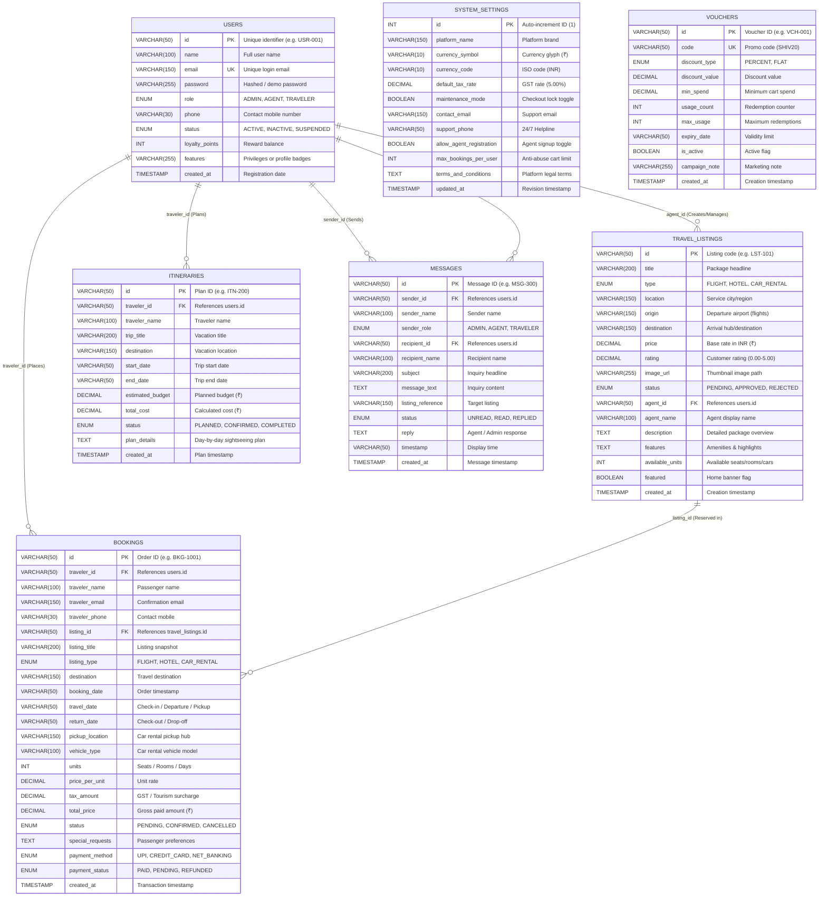

# 🗄️ SHIV TRAVELS - MySQL Relational Database Architecture & Guide

> **B.Tech Computer Science & Engineering — 3rd Semester Project**  
> **Project Title:** SHIV TRAVELS — Comprehensive Online Travel Booking Platform  
> **Target Database Engine:** MySQL 8.0+ / MariaDB 10.4+ (InnoDB Engine)  
> **Character Encoding:** `utf8mb4` with `utf8mb4_unicode_ci`  

---

## 📌 Table of Contents
1. [Overview & Highlights](#1-overview--highlights)
2. [Entity-Relationship (ER) Diagram](#2-entity-relationship-er-diagram)
3. [Relational Schema & Table Definitions](#3-relational-schema--table-definitions)
   - [Table 1: Users](#table-1-users)
   - [Table 2: Travel_Listings](#table-2-travel_listings)
   - [Table 3: Bookings](#table-3-bookings)
   - [Table 4: Itineraries](#table-4-itineraries)
   - [Table 5: Messages](#table-5-messages)
   - [Table 6: System_Settings](#table-6-system_settings)
   - [Table 7: Vouchers](#table-7-vouchers)
4. [Referential Integrity & Foreign Key Rules](#4-referential-integrity--foreign-key-rules)
5. [Database Setup Instructions (हिंदी एवं English)](#5-database-setup-instructions-हिंदी-एवं-english)
   - [Option A: MySQL Workbench (Graphical UI)](#option-a-mysql-workbench-graphical-ui)
   - [Option B: MySQL Command Line Client (CLI)](#option-b-mysql-command-line-client-cli)
   - [Option C: phpMyAdmin / XAMPP](#option-c-phpmyadmin--xampp)
6. [Java JDBC Dual-Mode Persistence Architecture](#6-java-jdbc-dual-mode-persistence-architecture)
7. [DBMS Viva Questions & Presentation Answers](#7-dbms-viva-questions--presentation-answers)

---

## 1. Overview & Highlights

SHIV TRAVELS employs a fully normalized **Relational Database Management System (RDBMS)** running on **MySQL 8.0 InnoDB**. 

### Key Architectural Strengths:
- **ACID Compliance**: Full support for Atomicity, Consistency, Isolation, and Durability via InnoDB transactional engine.
- **Referential Integrity**: Robust Primary Key (`PK`) and Foreign Key (`FK`) relationships with defensive delete and cascade update triggers.
- **Third Normal Form (3NF)**: Redundant attributes removed while retaining fast join capability.
- **Dual-Mode Persistence in Java**: The Java backend automatically synchronizes with MySQL. If MySQL credentials are not configured or the service is offline, SHIV TRAVELS gracefully operates in memory without crashing or interrupting user testing.

---

## 2. Entity-Relationship (ER) Diagram



---

## 3. Relational Schema & Table Definitions

### Table 1: `users`
Stores all account entities across the platform: **Administrators**, **Travel Agents**, and **Travelers**.
* **Primary Key:** `id` (VARCHAR(50))
* **Unique Key:** `email` (VARCHAR(150))
* **Key Columns:**
  * `role`: ENUM (`'ADMIN'`, `'AGENT'`, `'TRAVELER'`)
  * `status`: ENUM (`'ACTIVE'`, `'INACTIVE'`, `'SUSPENDED'`)
  * `loyalty_points`: INT (Accumulated reward points for redemption discounts)
  * `features`: Descriptive permission badges shown in user profile

### Table 2: `travel_listings`
Stores all travel packages: **Flights**, **Hotels**, and **Car Rentals**.
* **Primary Key:** `id` (VARCHAR(50))
* **Foreign Key:** `agent_id` REFERENCES `users(id)`
* **Key Columns:**
  * `type`: ENUM (`'FLIGHT'`, `'HOTEL'`, `'CAR_RENTAL'`)
  * `status`: ENUM (`'PENDING'`, `'APPROVED'`, `'REJECTED'`)
  * `price`: DECIMAL(12, 2) in Indian Rupees (₹)
  * `rating`: DECIMAL(3, 2) out of 5.00
  * `available_units`: Real-time stock counter (decremented upon booking)

### Table 3: `bookings`
Central ledger for customer bookings and simulated financial payments.
* **Primary Key:** `id` (VARCHAR(50))
* **Foreign Keys:**
  1. `traveler_id` REFERENCES `users(id)`
  2. `listing_id` REFERENCES `travel_listings(id)`
* **Car Rental Specific Columns:**
  * `pickup_location`: Station / Airport where vehicle is collected
  * `vehicle_type`: Vehicle category (e.g. `SUV / 4x4`, `Sedan`, `Convertible`)
* **Booking & Financial Lifecycle:**
  * `status`: ENUM (`'PENDING'`, `'CONFIRMED'`, `'CANCELLED'`)
  * `payment_method`: ENUM (`'UPI'`, `'CREDIT_CARD'`, `'NET_BANKING'`)
  * `payment_status`: ENUM (`'PAID'`, `'PENDING'`, `'REFUNDED'`)

### Table 4: `itineraries`
Personalized trip plans created by travelers.
* **Primary Key:** `id` (VARCHAR(50))
* **Foreign Key:** `traveler_id` REFERENCES `users(id)`
* **Key Columns:**
  * `trip_title`: Name of vacation plan
  * `estimated_budget`: Planned budget in ₹
  * `total_cost`: Actual calculated total
  * `plan_details`: Day-wise activities and sightseeing schedule

### Table 5: `messages`
Two-way communication desk connecting Travelers, Travel Agents, and Administrators.
* **Primary Key:** `id` (VARCHAR(50))
* **Foreign Keys:**
  1. `sender_id` REFERENCES `users(id)`
  2. `recipient_id` REFERENCES `users(id)`
* **Key Columns:**
  * `status`: ENUM (`'UNREAD'`, `'READ'`, `'REPLIED'`)
  * `reply`: Response text from Agent or Admin
  * `listing_reference`: Associated package identifier

### Table 6: `system_settings`
Platform parameters governed exclusively by the Platform Administrator.
* **Primary Key:** `id` (INT AUTO_INCREMENT)
* **Key Columns:**
  * `default_tax_rate`: GST percentage applied to bookings (default 5.00%)
  * `maintenance_mode`: Safety lock switch for booking transactions
  * `support_phone`: 24/7 Helpline numbers
  * `max_bookings_per_user`: Cart threshold to prevent abuse

### Table 7: `vouchers`
Promotional discount codes redeemable by travelers during checkout.
* **Primary Key:** `id` (VARCHAR(50))
* **Unique Key:** `code` (VARCHAR(50))
* **Key Columns:**
  * `discount_type`: ENUM (`'PERCENT'`, `'FLAT'`)
  * `discount_value`: Numerical value (e.g. 20.00% or ₹500.00)
  * `min_spend`: Minimum cart value required to unlock discount

---

## 4. Referential Integrity & Foreign Key Rules

| Child Table | Foreign Key | Parent Table | On Delete | On Update | Rationale |
|:---|:---|:---|:---|:---|:---|
| `travel_listings` | `agent_id` | `users(id)` | **RESTRICT** | **CASCADE** | An agent account cannot be deleted if active listings are listed under them. |
| `bookings` | `traveler_id` | `users(id)` | **RESTRICT** | **CASCADE** | Financial transaction records must be permanently retained for auditing. |
| `bookings` | `listing_id` | `travel_listings(id)` | **RESTRICT** | **CASCADE** | A listing cannot be deleted if customer reservations exist for it. |
| `itineraries` | `traveler_id` | `users(id)` | **CASCADE** | **CASCADE** | If a traveler account is purged, their personal trip drafts are deleted. |
| `messages` | `sender_id` | `users(id)` | **CASCADE** | **CASCADE** | Ensures messages clean up gracefully if a test user is deleted. |
| `messages` | `recipient_id` | `users(id)` | **CASCADE** | **CASCADE** | Ensures inbox clean up gracefully if a recipient is deleted. |

---

## 5. Database Setup Instructions (हिंदी एवं English)

All database scripts are located in the `database/` folder:
- **`database/setup_database.sql`**: Complete unified script (Schema + Baseline Data + Verification Queries). Recommended!
- **`database/schema.sql`**: Pure DDL table creation script.
- **`database/seed_data.sql`**: Pure DML baseline insertion script.

---

### Option A: MySQL Workbench (Graphical UI)
**हिंदी निर्देश:**
1. MySQL Workbench खोलें और अपनी Local Instance से जुड़ें (`root` user)।
2. टॉप मेनू में **File -> Open SQL Script...** पर क्लिक करें।
3. इस फ़ाइल को चुनें: `C:\Users\NITIN\OneDrive\Desktop\traviel\database\setup_database.sql`
4. कीबोर्ड पर **Ctrl + Shift + Enter** दबाएँ या पीले रंग के ⚡ (**Execute**) बटन पर क्लिक करें।
5. नीचे Action Output पैनल में सभी tables के आगे हरे रंग का टिक (Green Checkmark) दिखाई देगा।
6. बाएँ Navigator पैनल में `voyagehub_db` दिखाई देगा जिसमें सभी 7 tables बन चुकी होंगी।

**English Instructions:**
1. Launch MySQL Workbench and connect to your local MySQL connection.
2. Navigate to **File -> Open SQL Script...**
3. Select `database/setup_database.sql`.
4. Click the lightning bolt ⚡ icon or press **Ctrl + Shift + Enter**.
5. Refresh the Schemas navigator on the left to inspect `voyagehub_db`.

---

### Option B: MySQL Command Line Client (CLI)
**हिंदी निर्देश:**
Windows PowerShell या Command Prompt खोलें और नीचे दी गई कमांड चलाएँ:

```powershell
# MySQL में सीधे सेटअप स्क्रिप्ट इम्पोर्ट करें:
mysql -u root -p < "C:\Users\NITIN\OneDrive\Desktop\traviel\database\setup_database.sql"
```
*(जब पासवर्ड माँगा जाए, अपना MySQL root पासवर्ड दर्ज करें)*

यदि आप MySQL Shell के अंदर हैं:
```sql
SOURCE C:/Users/NITIN/OneDrive/Desktop/traviel/database/setup_database.sql;
```

---

### Option C: phpMyAdmin / XAMPP
1. XAMPP Control Panel से MySQL start करें।
2. Browser में `http://localhost/phpmyadmin` खोलें।
3. टॉप मेनू में **Import** टैब पर क्लिक करें।
4. **Choose File** में जाकर `database/setup_database.sql` चुनें और **Import / Go** पर क्लिक करें।

---

## 6. Java JDBC Dual-Mode Persistence Architecture

SHIV TRAVELS includes a robust Java database layer in package `com.travelbooking.database`:
- **`DBConfig.java`**: Reads settings from root `db.properties`.
- **`DBConnection.java`**: Manages MySQL connection testing and driver loading (`com.mysql.cj.jdbc.Driver`).
- **`DatabaseManager.java`**: Contains prepared statements for all CRUD operations and relational mapping.

### How to Connect Java with your MySQL Password:
प्रोजेक्ट के मुख्य फोल्डर में स्थित `db.properties` फ़ाइल खोलें:
```properties
db.host=localhost
db.port=3306
db.name=voyagehub_db
db.user=root
db.password=YOUR_MYSQL_ROOT_PASSWORD_HERE
db.autoSync=true
db.enabled=true
```

> [!NOTE]
> **Zero-Downtime Fallback Design:**
> यदि MySQL सेवा बंद हो या पासवर्ड अभी सेट न किया गया हो, तब भी प्रोजेक्ट कभी क्रैश नहीं होगा! SHIV TRAVELS स्वचालित रूप से सुरक्षित **In-Memory DataStore Mode** में चलेगा ताकि कॉलेज प्रेजेंटेशन या डेमो के दौरान कोई त्रुटि न आए।

---

## 7. DBMS Viva Questions & Presentation Answers

### Q1: Why did you choose InnoDB instead of MyISAM?
**Answer:** InnoDB supports **ACID transactions** and **Foreign Key constraints**, ensuring referential integrity across Users, Bookings, and Listings. MyISAM does not support Foreign Keys or row-level locking.

### Q2: How does the system prevent orphaned bookings?
**Answer:** The `bookings` table has Foreign Key constraints referencing `users(id)` and `travel_listings(id)` with `ON DELETE RESTRICT`. A listing or user cannot be accidentally deleted from the database while active reservations exist.

### Q3: What level of Normalization is implemented?
**Answer:** The database conforms to **Third Normal Form (3NF)**:
1. **1NF**: Every column contains atomic values, with dedicated primary keys (`id`).
2. **2NF**: No partial dependency exists; all non-key attributes depend on the full primary key.
3. **3NF**: No transitive dependencies exist. For example, booking prices store snapshots at the time of purchase rather than relying solely on fluctuating listing prices.

### Q4: How is Car Rental modeled relationally?
**Answer:** In `travel_listings`, car rentals are identified by `type = 'CAR_RENTAL'`. In `bookings`, specific rental attributes like `pickup_location` and `vehicle_type` are captured directly to support reservation logistics without requiring an extra table.
